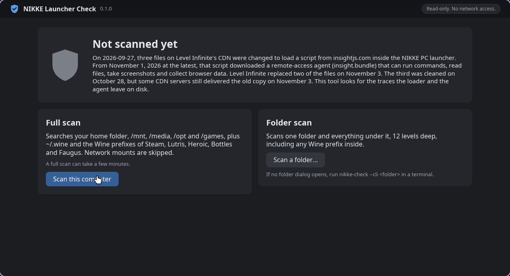
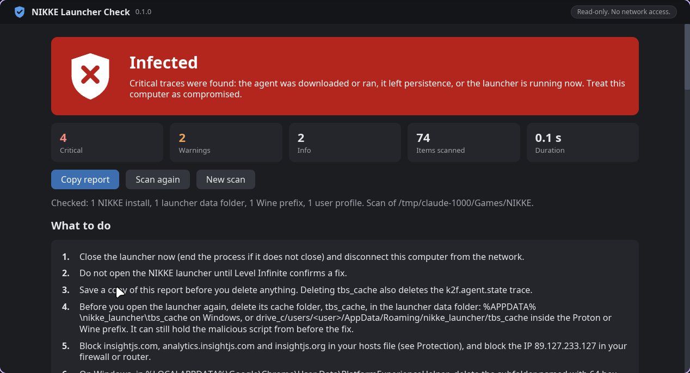

# NIKKE Launcher Check

NIKKE Launcher Check (`nikke-check`) looks for the traces left by the November 2026 compromise of the NIKKE PC launcher: the script loaded from insightjs.com, the remote-access agent that script downloaded, and the DLL and registry key the agent adds on Windows so that Google Chrome loads it. It only reads files: it does not change, move or delete anything, and it makes no network connections. The only file it writes is a report you save yourself with "Save report...". It also checks whether your hosts file blocks the malicious domains, but it never edits that file.

It runs on Windows, on Linux (Proton, Steam Deck, Lutris, Heroic, Bottles, Faugus) and on macOS, where NIKKE runs through Wine-based tools such as CrossOver, Whisky and Wineskin.

<p>
  
  
</p>

## Download

Download the file for your system from the [latest release](https://github.com/MotherSphere/NIKKE-Launcher-Check/releases/latest).

| System | File |
|---|---|
| Windows, 64-bit | `nikke-check-windows-x86_64.exe` |
| Linux and Steam Deck, 64-bit (glibc 2.35 or later) | `nikke-check-linux-x86_64` |
| macOS on Apple silicon | `nikke-check-macos-arm64` |

Each release also has `SHA256SUMS.txt`, the SHA-256 of each file. [Check the download](docs/usage.md#check-the-download) shows how to compare it on each system.

## Quick start

### Windows

Double-click `nikke-check-windows-x86_64.exe`. The program is not signed, so SmartScreen can warn about an unknown publisher. Click "More info", then "Run anyway".

### Linux and Steam Deck

A browser download loses the permission to run the file. On a Steam Deck, switch to Desktop Mode and open Konsole. Open a terminal and run these commands. The first one goes to the Downloads folder; if you saved the file somewhere else, use that folder.

```
cd ~/Downloads
chmod +x nikke-check-linux-x86_64
./nikke-check-linux-x86_64
```

### macOS

Gatekeeper blocks unsigned programs. Open Terminal and run these commands. The first one goes to the Downloads folder; if you saved the file somewhere else, use that folder.

```
cd ~/Downloads
chmod +x nikke-check-macos-arm64
xattr -d com.apple.quarantine nikke-check-macos-arm64
./nikke-check-macos-arm64
```

### In the window

The window opens with three buttons. "Scan this computer" is a quick scan: the install paths the launcher records, the usual Wine prefix folders, and every folder up to 5 levels deep, usually in seconds. "Full scan" opens every folder on every local drive, for an install the quick scan misses. "Scan a folder..." scans one folder you pick, such as a game library on another drive.

The result has three tabs. "What happened" answers four questions: did the malware run, is anything still active, is there something to clean up, and are you protected for next time. "What to do" lists only the steps that match what the scan found, in order, with buttons that open the folder to clean, Task Manager or Registry Editor, or copy a path, a key or a command. The tool never deletes anything itself. "Details" has every finding, the files the agent could read, and the locations checked.

"Save report..." writes the text report to a file you choose, and "Copy report" puts it on the clipboard. Turn on "Hide my info" before you share it: it replaces your computer name, user names, agent ID and home folder in the saved or copied report (`--redact` on the command line). [Using the tool](docs/usage.md) covers the window, the report and the `--cli` mode.

### Language

The window and the report use the language of your system, so most people have nothing to set. The tool has 16 languages: English, Japanese, Korean, Simplified Chinese, Traditional Chinese, Thai, Vietnamese, Indonesian, French, German, Spanish, Portuguese (Brazil), Russian, Polish, Turkish and Italian. If the system language is not one of them, the tool tries the next language in the system's list of preferred languages, and uses English when none matches. The country does not matter, except for Chinese: French from Canada gives French and Portuguese from Portugal gives Portuguese (Brazil), while Chinese from Taiwan, Hong Kong or Macau gives Traditional Chinese and other Chinese gives Simplified Chinese.

To switch, open the menu at the bottom left of the window. It shows the current language under its own name, such as 日本語 or Français. The change applies at once, also to a result already on screen and to the saved or copied report, without a new scan. The choice is not saved: the next start uses the system language again. To start in one language, add `--lang` and its code, such as `--lang fr` or `--cli --lang ja`. [Language](docs/usage.md#language) lists the codes, how the system language is read on each system, and how to make a Windows shortcut that always opens in one language.

## Verdicts

| Verdict | Meaning |
|---|---|
| No traces found | No trace of the malicious script or the agent was found in the NIKKE files this scan located. |
| Exposed | The launcher loaded the malicious script or contacted insightjs.com, but no sign that the agent ran was found. |
| Infected | Critical traces were found: the agent was downloaded or ran, the launcher contacted analytics.insightjs.com, or the agent left persistence. Treat this computer as compromised. |
| NIKKE not found | No NIKKE install or launcher data was found in the places this scan checked. |

Finding nothing is not proof that the computer is clean. [What it checks](docs/checks.md) lists the traces behind each verdict, and [Using the tool](docs/usage.md#command-line) has the `--cli` exit codes.

## What to do

If the result is Infected, start with these steps:

1. Close the NIKKE launcher now (on Windows, if it does not close, open Task Manager with Ctrl+Shift+Esc and end nikke_launcher.exe) and disconnect this computer from the network.
2. Click "Save report..." before you delete anything. Deleting the launcher cache also deletes one of the traces.
3. Before you open the launcher again, delete its cache folder, `tbs_cache`. Level Infinite confirmed a fix on November 4, 2026, but the cache can still hold the modified files, and the launcher would load them again.

Then follow the "What to do" tab, or [What to do](docs/what-to-do.md#infected). It covers the launcher cache, blocking the domains and the attacker's two IP addresses, removing the DLL and its registry key on Windows (the key first, then a restart, then the DLL folder), and changing your passwords from a clean device (a phone or another computer that never ran the NIKKE launcher).

Whatever the result, delete `tbs_cache` before you open the NIKKE launcher again. Scan first, or copy the folder, if you want to keep the evidence. Keep the domains and the two IP addresses blocked: it is still unknown how the attacker got write access to the CDN. If the result is Exposed and the launcher was open on or after October 23, 2026, also change your passwords from a clean device. [What to do](docs/what-to-do.md#exposed) has the steps.

## Documentation

- [Using the tool](docs/usage.md): checking the download, the window and its tabs, the language and how it is detected, saving and redacting the report, the command line and its exit codes.
- [What to do](docs/what-to-do.md): the steps for each verdict, with the paths to clean on each system.
- [What happened](docs/incident.md): the incident, a timeline and the indicators of compromise.
- [What it checks](docs/checks.md): every check and its severity, how the verdict is chosen, and the limits.
- [Where it looks](docs/locations.md): the search locations on Windows, Linux and macOS, and how Wine prefixes are read.
- [Building and releases](docs/building.md): building from source, the tests, CI and the release process.

## The incident

On 2026-09-27, four files on Level Infinite's CDN were changed to load a script from insightjs.com inside the NIKKE PC launcher. From October 23, 2026 at the latest, on some launches, that script downloaded a remote-access agent that can run commands, read files, take screenshots and collect browser data. [What happened](docs/incident.md) has the details. The full analysis is in this write-up: https://gist.github.com/MotherSphere/d6c049a09ba8ac3085c51ee9df24a4e5

## License

GPL-3.0-or-later. See [LICENSE](LICENSE).
